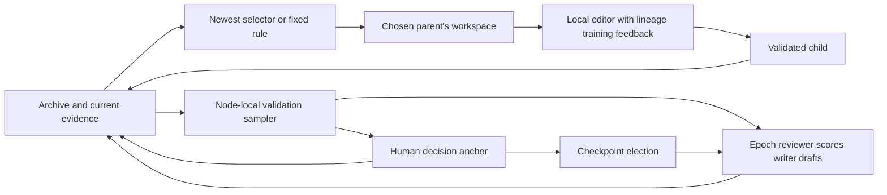

# Editable parent selection in the Red Queen Gödel Machine

This project extends the Red Queen Gödel Machine (RQGM), an evolutionary framework for recursive self-improvement under non-stationary utilities, with editable expansion-parent selection as studied in Appendix E.5 of *HyperAgents*. [RQGM](https://arxiv.org/abs/2606.26294v3) · [HyperAgents Appendix E.5](https://arxiv.org/pdf/2603.19461v2#page=60)

In plain words, the system keeps a family tree of paper-writing and reviewing programs. To grow the tree, the newest valid version runs a rule that picks a version to build on, possibly itself. That chosen version is the **expansion parent**. Its editor makes a child and can rewrite the child's rule for picking the next parent. The reviewer that judges new drafts stays fixed within each search epoch and can change at a checkpoint based on agreement with human decisions. That changing standard is what “non-stationary” means here. [RQGM Algorithm 1](https://arxiv.org/html/2606.26294v3#A2.SS4) · [HyperAgents Algorithm 5](https://arxiv.org/pdf/2603.19461v2#page=61)

Does permission to edit and execute the parent-selection rule improve prediction of historical conference decisions over fixed subtree Thompson sampling? The registered study uses a frozen local Qwen3.5-4B and executable writer, reviewer, editor and selector programs. The primary outcome is a paired accuracy difference on a balanced sample of the released manuscripts. [Preregistration](reports/preregistration.md) · [Published dashboard](https://burnycoder.github.io/selfimproving-agent-red-queen-godel-machine-with-evolvable-parent-selection/) · [Study progress](reports/progress.md)

An independent audit found acknowledgments headings strongly associated with acceptance in the development manuscripts. The amended cleaner preserves the enrolled papers. Manuscript length still differs between classes, and the versions available at the time of the historical decisions remain uncertain. [Audit, counts and limitations](reports/reviews/independent-scientific-audit.md) · [Manuscript evidence](results/manuscript-audit.json)

Our implementation builds on OpenRQGM. Changing reviewers invalidates earlier reviewer-dependent measurements while preserving human-anchored evidence. Native clade sampling, fixed uniform sampling, the HyperAgents handcrafted rule and the initial reviewer provide comparisons. [October RQGM](https://arxiv.org/html/2606.26294v3#A2.SS4) · [OpenRQGM](https://github.com/DreamFallenFlowers/OpenRQGM/tree/feecb32d9fbdd1c60749ade9ecb47f971e12666e)

## Experiment design

[Exact run matrix](reports/planned-runs.md) · [Literature review](reports/literature-review.md) · [Source and formula audit](reports/state-of-the-art-review.md) · [Plan](reports/plan.md) · [Split fingerprints](results/split-manifest.json)

The pilot compares all four search arms on one seed. Confirmation pairs eight editable/native seeds with two additional controls on the first five. A fork at the midpoint of the first editable search switches future parent choices to the native rule while keeping selector editing available. All eligible test endpoints are frozen together before sealed scoring. The primary uncertainty interval resamples paired search seeds and shared test papers within historical decision class. [Run matrix](reports/planned-runs.md) · [Analysis rules](reports/preregistration.md)

| Runs | Seeds | Expansion rule | Search and evaluation |
|---|---|---|---|
| Initial reviewer | 0 | Unevolved root | Score the pilot set, then the jointly sealed test set |
| Pilot | 0 | Editable, native Thompson, fixed uniform, released handcrafted | 64 validation steps per arm, 24 independent pilot papers |
| Primary comparison | 1–8 | Editable and native Thompson | Choose 64, 128 or 256 steps from timing alone; score on the same 100 test papers |
| Secondary controls | 1–5 | Fixed uniform and released handcrafted | Same common budget and test set |
| Mechanism intervention | 1 | Editable archive switched to native selection | Resume from the common midpoint and measure its descendants and endpoint |
| Formula replay | All searches | Released vs paper child penalty | Compare decisions on identical archived evidence with the same random draw |

## Reproduction

For the scientific audit, run the following from the repository root. Preparation verifies or retrieves the pinned source CSV. The audit regenerates the numerical checks, tables, figures, paper and dashboard from the saved evidence. The environment flag disables the model broker before it can connect to a service.

~~~powershell
uv sync --locked
$env:RQGM_DISABLE_MODEL = '1'
uv run --locked rqgm-study prepare
uv run --locked rqgm-study selftest
uv run --locked rqgm-study audit
~~~

The separate research campaign below requires a model-enabled process.

Use Python 3.12 and uv, Ollama with the registered local model digest, and Ubuntu WSL with bubblewrap (Linux can invoke bubblewrap directly). The package exposes a single study CLI. Large private inputs, full local inference traces and environment credentials stay out of version control. The procedural paper and aggregate tables are regenerated from tracked results.

~~~powershell
uv sync --locked
uv run --locked rqgm-study prepare
uv run --locked rqgm-study selftest
uv run --locked rqgm-study campaign
uv run --locked rqgm-study report
uv run --locked rqgm-study serve
~~~

The campaign preflights GPU residency, scores the root, and interleaves program editing with validation. A checkpoint can replace the judge of writer drafts. After selecting the search budget from pilot timing and freezing the eligible confirmatory reviewers, the harness scores them on the sealed manuscripts. Restart the campaign command to resume. [Installation, dashboard and individual commands](docs/usage.md) · [Methodological review](reports/reviews/methods.md) · [Public study archive on Hugging Face](https://huggingface.co/BurnyCoder/rqgm-editable-parent-selection)

## Milestones

- [x] Pin publications, upstream implementation and source dataset; register paper-disjoint splits.
- [x] Ship the CLI and check the scheduler, inheritance, erasure, fallback and resume. [Engineering results](results/engineering.json) · [Prospective cleaning amendment](reports/amendments.md)
- [ ] Run the local pilot and choose the confirmatory budget from throughput.
- [ ] Freeze and score all confirmatory endpoints, publish comparisons and limitations.

<!-- GENERATED: outcomes -->
## Observed results

The primary hypothesis is untested. No complete editable–native pair has been scored on the sealed manuscripts.

No endpoint predictions have been recorded.

[Full report, compute and uncertainty](reports/summary.md) · [Examples and lineage explorer](https://burnycoder.github.io/selfimproving-agent-red-queen-godel-machine-with-evolvable-parent-selection/) · [Paper PDF](reports/paper.pdf)
